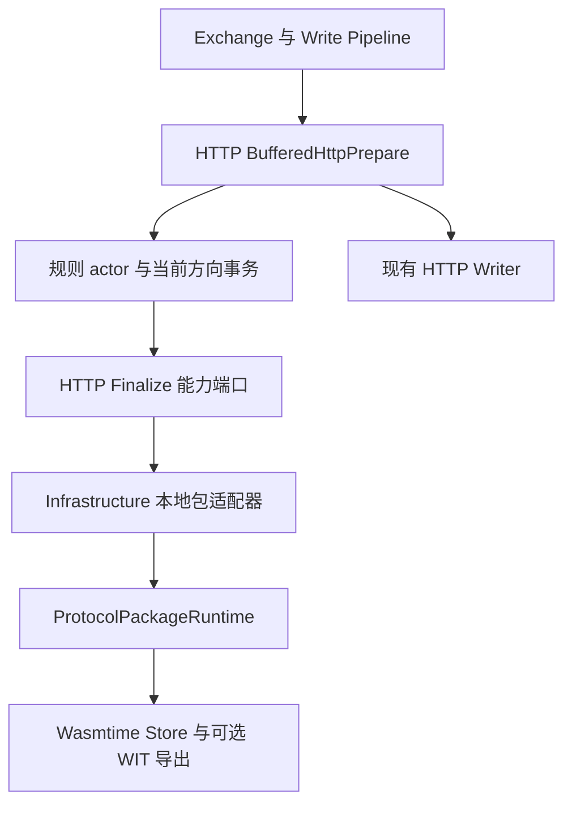

# 本地 Wasm HTTP Finalize

HTTP 协议包可以在正文规则和 Encode 完成后，修改即将写出的 HTTP 信息。该能力只用于本地 Wasm
Component；远端 `/packages` JSON-RPC 与 Socket 合同保持原样。

本章是当前实现的架构与包接口说明。设计取舍由
[ADR-011](decisions/ADR-011-http-finalize-capability.md) 记录；共享交换模型见
[Exchange 与 Pipeline](exchange-pipeline.md)。“最后”指本轮业务写准备的最后阶段，后面仍有
故障注入和实际 Writer，不代表报文已经发送成功。

## 分层与职责



箭头表示运行时调用；编译依赖仍由 Infrastructure 指向 Proxy/Exchange 的稳定端口。
Exchange 不依赖 Wasmtime、SQLite、HTTP 包 JSON 或具体包身份。

| 层与对象 | 拥有的职责 | 不承担的职责 |
| --- | --- | --- |
| `Exchange` / `Write` | 连接级顺序、准备结果观察、Writer 调用、失败传播 | HTTP 五字段 JSON、包选择、业务算法 |
| `BufferedHttpPrepare` | 当前交易和请求关联；普通/Mock 分派；实际 URI 同步 | Wasm ABI、生命周期存储 |
| HTTP `Finalize` | 表达最终 HTTP 变换能力，使用原生 Message | 网络写入、规则提交、Socket 编码 |
| `JointDocumentEvaluation` | 本轮 Document、Encode、Finalize 资源 | 第二条 Pipeline、独立持久化提交 |
| 规则 actor | 有序规则、Encode、正文动作、Finalize、生命周期提交与回滚 | 包 JSON 细节、Wasmtime 调用 |
| `ExternalHttpFinalizeCall` | 五字段投影、包调用、返回校验和差量写回 | 包内业务判断、TCP 写出 |
| `InProcessWasmRuntime` | 运行时代、Store 串行调用、替换与停用取消 | URL/Header 规则、交易关联 |
| Wasm 包 | 决定允许字段的修改，返回完整 HTTP JSON | Proxy 事务提交、固定上游连接重选 |

### 为什么端口定义在 HTTP 层

现有 `Encode<P, D>` 操作 Document 与协议 Context。Finalize 还需要同一交易的请求关联，且必须
保存原始 Header 字节、重复头、状态行和正文 codec。因此独立 trait 定义在 Proxy HTTP 层，
直接使用 `HttpRequestMetadata` 与 `Message`，不往共享 `Protocol::Context` 增加 HTTP 特有字段。

这保留了独立能力、工厂装配和异步错误传播的既有风格。方向由 HTTP 方向能力装配和具体 Wasm 导出
共同确定；本次没有为 Socket 定义对应方法。

## 可选导出与旧包兼容

```wit
upstream-finalize: func(http-json: string) -> result<string, package-error>;
downstream-finalize: func(http-json: string) -> result<string, package-error>;
```

两个导出独立可选。旧 `http-package` world 不增加必需函数，旧包无需修改或重新打包。包作者按实际
需要选择 [WIT](../../src-tauri/crates/package-runtime/wit/protocol-package.wit) 中的 world：

| World | 新增导出 |
| --- | --- |
| `http-package` | 无 |
| `http-package-upstream-finalize` | `upstream-finalize` |
| `http-package-downstream-finalize` | `downstream-finalize` |
| `http-package-finalize` | 上下行两个 Finalize |

Host 校验旧必需函数，同时发现并校验可选导出。同名导出不是函数或签名不正确时，包加载失败；
只有确实不存在的导出才按无此能力处理。每次调用沿用该精确包版本的 Store、串行调用和取消生命周期。

加载时先区分导出是否存在、是否为函数，再校验 WIT 签名；写准备时询问当前运行时的方向能力。
缺少可选导出才跳过。离线、导出类型错误、或“声明有能力但调用返回无能力”都是错误。
扩展 world 包含原 world；Manifest API 版本、Schema 和远程 RPC 方法集合不变。

## HTTP JSON

输入与返回都是一个 JSON 字符串，包含相同的五个字段，没有 request/response 包装或 Proxy 元数据。

```json
{
  "url": "/orders/123?format=json",
  "method": "POST",
  "code": 200,
  "header": {
    "Content-Type": "application/json"
  },
  "body": "{\"status\":\"ready\"}"
}
```

| 字段 | upstream | downstream |
| --- | --- | --- |
| `url` | 当前 App 请求的 URI/target | 同一交易原始请求的 URI/target |
| `method` | 当前请求方法 | 同一交易请求方法 |
| `code` | `null` | 当前响应状态码 |
| `header` | 当前请求头对象 | 当前响应头对象 |
| `body` | 当前请求正文字符串 | 当前响应正文字符串 |

`url` 保留实际请求的表示形式：请求使用绝对 URI 时保留绝对形式，使用路径与查询参数时保留该形式。
Host 不根据 Listener 标识或上游连接地址猜测协议和域名。

`header` 的值为字符串。同名 HTTP 头按大小写不敏感语义分组，输入 JSON 取最后一个值；包返回的
同名字段同样采用最后值。未改动的头继续保留原始线上的重复项和空白；修改某个头时，按现有
SetHeader 语义删除该名字的旧项并写入返回值，删除键则删除该名字的全部项。完整输入原样返回时
保持原始消息，不因为 JSON 投影而丢失其他重复头。

upstream 只能修改 URL 的 path/query；scheme、authority（主机及端口）和 method 保持不变。
相对 URI 不能通过 Finalize 变成另一个绝对目标。downstream 的 url/method 是关联信息，必须保持
不变。允许的请求路径修改同步到实际发送目标和请求行，不改变固定的 Server 连接目标。

Host 用返回 JSON 构造实际 HTTP 消息。App 收到正常状态行、Header 和 `body`，不会把这层 JSON
包装作为业务正文接收。返回信息必须满足字段类型、不可变字段和 HTTP 消息校验。
`body` 字符串沿用本轮 HTTP 流水线已经选定的正文 codec；正文未变化时保留原始字节，变化时编码并
复用现有 framing 更新。修改 Header 不会重新选择正文 codec。

五个字段全部必填，upstream 的 `code` 必须显式为 `null`。缺字段、额外字段、错误类型、非法 JSON
和不合法的 HTTP 字段均不能作为成功输出。Header 进入字符串接口时使用严格 UTF-8，不做有损替换。

例如原消息有 `X-Tag: first` 和 `x-tag: last`，包看到有效值 `last`。原样返回时两条原始头保留；
改成 `new` 时删除两条旧项并写入一个新值；删除键则删除全部同名项。本接口不能创建多个新同名值。

## 调用顺序与失败

HTTP 层定义独立的 `Finalize` 能力端口：

```rust
#[async_trait]
pub trait Finalize: Send {
    async fn finalize(
        &mut self,
        request: &HttpRequestMetadata,
        message: &mut Message,
    ) -> Result<(), Error>;
}
```

它与 Decode、Display 和写准备能力一同装配到 HTTP 方向能力中。端口直接使用 HTTP 请求关联和
原始 `Message`，不把 HTTP 特有字段加入共享 Exchange Context，也不扩展 Socket。
本地 Wasm 实现持有当前包、方向和正文 codec；正常规则事务与 Mock 复用同一调用实现。

```text
Rules → 条件性 Encode → 完成本轮正文动作
  → 可选 Finalize → HTTP 消息写回 → 当前方向规则生命周期提交
  → 现有故障注入和 Writer
```

方法存在时，每次该方向写准备调用一次，不依赖规则是否命中、Document 或正文是否变化，也不依赖
Encode 是否实际执行。本机应答经过相同写准备。旧 MockResponse 已生成响应时直接调用独立的
Finalize 能力，保持过去的 Rules/Encode 执行次数。

包不处理某次业务输入时，应返回收到的完整 JSON，保留已完成的规则改动。该业务决定与包加载错误、
trap、取消、运行时停用或不合法返回不同；后者通过 Finalize 错误传播，不能回退发送旧正文或报告成功。

正常规则事务在 Finalize 成功后才提交当前方向的生命周期增量；失败回滚当前方向的规则工作状态。
已经完成的另一方向不倒退。故障注入仍能按配置制造异常，Finalize 不自动修复主动注入的故障。

### 正常请求与响应时序

```mermaid
sequenceDiagram
    participant Read as HTTP Reader Pipeline
    participant Prepare as BufferedHttpPrepare
    participant Adapter as ExternalHttpPrepare
    participant Actor as RuleRuntime actor
    participant Joint as JointDocumentEvaluation
    participant Package as Local Wasm Runtime
    participant Store as Rule Repository
    participant Writer as HTTP Writer
    Read->>Package: Decode 与 Display
    Read-->>Prepare: Envelope 与原始 Message
    Prepare->>Adapter: prepare 当前方向和请求关联
    Adapter->>Actor: 本轮 Joint evaluation
    Actor->>Joint: 有序规则与条件性 Encode
    Joint->>Package: Document 变化时 Encode
    Actor->>Actor: 应用本轮 HTTP 正文动作
    Actor->>Joint: Finalize.finalize
    Joint->>Package: 可选方向 Finalize 与完整 HTTP JSON
    Package-->>Joint: 完整返回 JSON 或错误
    alt 校验及写回成功
        Joint-->>Actor: 准备好的 Message
        opt 存在生命周期增量
            Actor->>Store: commit_runtime_deltas
            Store-->>Actor: 提交结果
        end
        Actor-->>Prepare: Message 与故障动作
        Prepare->>Writer: 使用现有写出路径
    else Finalize 失败
        Actor->>Actor: 恢复当前方向 checkpoint
        Actor-->>Prepare: Finalize 错误，结束本次写出
    end
```

未命中规则、Document 未变或 Encode 被跳过，不会跳过已经存在的 Finalize。其输入在本轮正文动作
完成后构造。Finalize 修改 HTTP Message，不再回写规则 Document，不触发第二次 Decode/Display。

### Mock 与本机应答

`HttpDirectionCapabilities` 分别持有 `prepare` 和 `finalize`。普通协议包路径由 actor 内的
`JointDocumentEvaluation` 调用 Finalize；旧 MockResponse 已生成响应，其 downstream 写准备
直接调用单独装配的 Finalize。两者委托同一 `ExternalHttpFinalizeCall`，复用投影、校验和 codec。

Mock 不再有专门的 `finalize_only` 方法，也不重跑原先跳过的 downstream Rules/Encode。
普通路径外层不会再次调用 Finalize，避免双调用。普通 LocalServer 响应按已有响应写准备流程执行；
它与旧 MockResponse 分支的含义不同。

### 请求关联与实际 URI

每笔交易开始时从 App 请求行保存原始 URL，归属于该连接当前 HTTP transaction。upstream 改变
path/query 后，同时更新请求行和实际发送 URI 的 path/query，保留实际 URI 的 scheme/authority
与既定连接目标。downstream 使用 App 原始 URL/method，不从响应反推，也不使用被 upstream
Finalize 改过的路径。请求 Message 移交 Writer 后，原始请求关联仍保留到响应准备结束。

例如 App 请求 `/before?value=before`，upstream 返回 `/upstream?value=upstream`：上游收到新路径，
downstream 的 `url` 仍为 `/before?value=before`。后续交易拥有自己的关联，没有全局 URL/token 缓存。

## 所有权、提交与取消

| 资源 | 所有者与有效期 | 结束方式 |
| --- | --- | --- |
| App 原请求关联 | 单连接当前 HTTP transaction | 本笔交易结束或连接关闭 |
| `ExternalHttpObserved` | Decode 产生，普通准备或 Mock Finalize 取走一次 | 随本轮处理作用域释放 |
| Listener 事务 guard | Decode 取得，随 evaluation 转交 | 正常路径在 Finalize 与生命周期提交后释放；Mock 在独立 Finalize 后释放 |
| checkpoint / deltas | actor 当前方向求值 | 准备成功后提交；失败恢复 checkpoint |
| 候选 Message | Finalize 写回函数局部拥有 | 全部校验成功才替换；失败丢弃 |
| Wasmtime Store | 精确本地版本的运行时代 | 调用串行；替换/停用取消旧代未完成调用 |

actor 显式保留 joint transaction 到提交完成，避免 Encode 或 Finalize 返回时过早释放 Listener
guard。运行时替换和停用沿用既有代际取消模型，不把取消报告成成功；本次不增加 Hook 超时或重试。

生命周期提交与网络写出是两个边界：Finalize 成功且有 deltas 时先提交，然后进入 Writer。
Finalize 失败不消耗本轮规则命中次数；之后的 Writer 失败遵循既有写出失败合同，不能称为
“Finalize 回滚”。已成功的另一方向不回退。

## 原子写回与错误边界

Host 先校验 method、URL、方向对应的 code，再在候选 Message 上处理状态行、Header 和正文，
最后校验完整 HeaderMap。全部成功才替换原消息，错误不会留下部分 Header 或正文修改。

状态行不变时保留版本与 reason 字节；upstream 改路径时保留请求版本，downstream 改 code 时
按现有状态构造方式产生新状态行。正文不变则保留 wire bytes；正文变化则复用 `replace_body`
和 framing。后续故障注入仍可按配置主动破坏正常传输。

| 条件 | 结果 |
| --- | --- |
| 方向导出确实不存在 | 保持消息并继续 |
| 业务不适用，返回完整输入 | 正常成功，保留先前规则改动 |
| 导出不是函数或签名错误 | 加载失败，不当作缺少能力 |
| 离线、停用、旧代取消、guest error 或 trap | 传播 Finalize 调用错误，不发送旧消息兜底 |
| 输出格式/字段/HTTP 校验失败 | 候选消息不替换，当前方向工作状态回滚 |
| method、upstream origin 或 downstream URL 被改 | Finalize 合同错误 |
| Finalize 成功但生命周期持久化失败 | 传播已有仓储错误，不交给 Writer |

## 观察

读时 Display 和规则后的 Document 保持各自阶段的含义，不额外调用一次 Decode/Display。
`encoded` 表示包含 Finalize 结果的写准备输出，`sent` 表示实际写出结果。失败事件使用 `finalize`
阶段，并保留包身份、方向、实际导出方法名和稳定错误。最终报文应以 `encoded`、`sent` 和对端收到的
内容核对，不能仅凭规则 Document 判断。

`ErrorStage::Finalize` 定位 Pipeline 阶段，`ExternalPackageCallStage::Finalize` 补充包身份、方向
与实际导出方法；观察层投影到现有应用诊断模型和生成的前端类型。

## 代码导航

| 查看内容 | 源码入口 |
| --- | --- |
| 独立 Finalize trait | [finalize.rs](../../src-tauri/crates/proxy/src/http/finalize.rs) |
| HTTP 联合事务端口 | [joint.rs](../../src-tauri/crates/proxy/src/http/joint.rs) |
| 方向能力装配合同 | [capabilities.rs](../../src-tauri/crates/proxy/src/http/capabilities.rs) |
| 当前交易与普通/Mock 分派 | [exchange_runtime.rs](../../src-tauri/crates/proxy/src/http/exchange_runtime.rs) |
| 实际 URI 同步 | [request_target.rs](../../src-tauri/crates/proxy/src/http/exchange_runtime/request_target.rs) |
| 本地包方向能力装配 | [external_http.rs](../../src-tauri/crates/infrastructure/src/adapters/listener_runtime/http_protocol_pipeline/external_http.rs) |
| 本轮 Document/Encode/Finalize 资源 | [joint_document.rs](../../src-tauri/crates/infrastructure/src/adapters/listener_runtime/joint_document.rs) |
| JSON 与原子写回 | [http_finalize.rs](../../src-tauri/crates/infrastructure/src/adapters/listener_runtime/http_finalize.rs) |
| checkpoint、提交和 guard 释放 | [actor.rs](../../src-tauri/crates/infrastructure/src/adapters/pipeline/rule_runtime/actor.rs) |
| 可选导出发现与调用 | [finalize.rs](../../src-tauri/crates/package-runtime/src/wasm_component/finalize.rs) |
| 运行时代与取消 | [in_process_wasm.rs](../../src-tauri/crates/infrastructure/src/adapters/in_process_wasm.rs) |

## 回归入口

通用测试包源码位于
[http-finalize fixture](../../src-tauri/crates/package-runtime/tests/fixtures/http-finalize/src/lib.rs)。
测试构建使用 `wasm32-wasip2`，各 feature 组合使用独立的 target 目录。

```bash
cargo test --manifest-path src-tauri/Cargo.toml -p intercept-proxy-package-runtime --test wasm_http_finalize
cargo test --manifest-path src-tauri/Cargo.toml -p intercept-proxy-infrastructure --lib http_finalize
cargo test --manifest-path src-tauri/Cargo.toml -p intercept-proxy-runtime --lib finalize
```

数据库保持 Schema 100，Finalize 不增加表、字段或 Manifest 持久化字段。兼容测试重新打开既有
Schema 100 数据库，核对 Workspace、包内容及启用状态，并用旧 Component 验证原 Decode/Encode。
这些测试不代表旧于 Schema 100 的数据库迁移、真实设备或外部业务链路已经验收。

| 层级 | 直接证明的合同 |
| --- | --- |
| Component ABI | 旧包、无/单向/双向导出、签名/非函数拒绝、guest error/trap、重复调用 |
| HTTP 字段 | Header 最后值和原字节保留、五字段必填、不可变字段、非法输出原子拒绝 |
| 规则事务 | 未命中/Encode 跳过仍调用、正文动作后输入、失败不提交、guard 跨提交 |
| Mock | 复用能力、保持 Rules/Encode 次数、失败为 Finalize 且不写出 |
| 实际 wire | 同一 path_id 的客户端输入、上游收到/响应、App 收到和 Content-Length |
| 生命周期 | 替换、停用、阻塞调用取消、能力随运行时代变化 |
| 持久化 | Schema100、Workspace、包字节和启用状态保留，旧包原方法可用 |
| 观察与静态 | 失败阶段/包信息、Rust 与前端类型、架构边界和文档链接 |

实际验收以任务归档的命令、输入输出、资源快照和审查结论为准；矩阵不能替代未执行的设备、
外部服务、安装包或 CI 结果。
